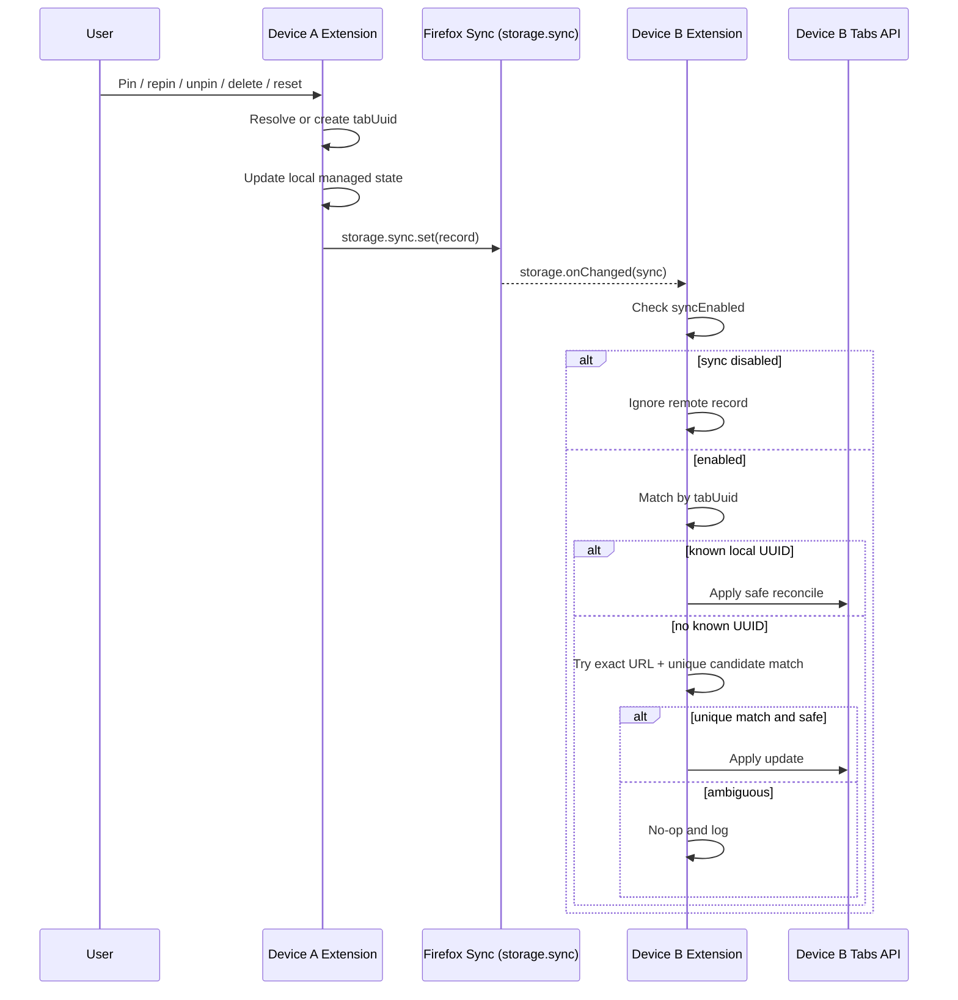

# Pinned tab sync strategy (Firefox Sync)

## Goal

Sync managed pinned-tab metadata across Firefox devices using Firefox Sync only, while keeping the feature optional, conservative, and safe.

## Out of scope

- External sync providers or custom backend services.
- Syncing arbitrary browser tabs that are not managed by this extension.
- Automatically closing tabs during reconciliation.

## Product behavior

- Sync is optional and disabled by default.
- Users must explicitly enable sync in extension settings before any sync writes or reads occur.
- The feature is implemented as a global profile-level toggle.
- The first release syncs:
  - managed tab identity
  - home URL
  - pin state
- The initial “managed” concept is limited to tabs that this extension already knows about or has explicitly marked as managed.

## Design principles

1. URL is not the canonical identity.
   - A URL can be shared across multiple tabs or devices.
   - The extension must generate and persist a stable UUID for each managed tab.

2. Safety beats convenience.
   - If a remote match is uncertain, the extension does nothing and logs the ambiguity instead of making a risky change.

3. Local state remains the source of truth unless a remote record is newer and safely matched.

4. Sync must be reversible and transparent.
   - Local delete, remote delete, and repin events must behave predictably.

## Data model

### Local state

The extension keeps local tab metadata in `browser.sessions` and/or a managed mapping keyed by local tab ID.

Example local record:

```json
{
  "tabId": 42,
  "tabUuid": "7b95533e-8b42-4d4f-b1d7-7bace5df8246",
  "homeUrl": "https://example.com/",
  "pinned": true,
  "managed": true,
  "lastUpdated": 1731196800000
}
```

### Synced state

All synced records live in `browser.storage.sync` and are keyed by `tabUuid` rather than by URL.

Example remote record:

```json
{
  "schemaVersion": 1,
  "tabUuid": "7b95533e-8b42-4d4f-b1d7-7bace5df8246",
  "homeUrl": "https://example.com/",
  "pinned": true,
  "status": "managed",
  "updatedAt": 1731196800000,
  "deviceId": "firefox-device-a",
  "actionSeq": 42,
  "urlHint": "https://example.com/"
}
```

### Storage keys

- Local feature flag: `browser.storage.local.syncEnabled` (`boolean`, default `false`)
- Local tab mapping: `browser.storage.local.managedTabs` or per-tab session entries
- Synced records: `browser.storage.sync[tabUuid]`

## Identity model

A managed tab must receive a stable UUID once it is known to the extension.

### UUID assignment rules

1. If a tab is already known and has a UUID, preserve it.
2. If a tab is newly managed, generate a new UUID and store it locally.
3. Use the UUID as the canonical identity across devices.
4. Keep `homeUrl` as a strong fallback signal only for migration and ambiguous matching, never as the only identity.

This differs from the original URL-keyed design and is necessary because multiple tabs can share the same URL and multiple devices can have different tab instances for the same page.

## Matching and reconciliation rules

Remote changes are applied only when confidence is high.

### Safe match policy

A remote record is considered a valid match when all of the following are true:
- `syncEnabled === true`
- the local tab is effectively managed by this extension
- the local tab either matches the known `tabUuid` or has exactly one exact URL candidate match
- the exact URL match is unique among local candidate tabs
- the local tab is currently pinned or previously known as managed
- no stronger local record is newer than the remote record

### Conservative fallback

If there is ambiguity or no confident match:
- do not apply the remote change
- keep the synced record intact
- log the reason for the no-op
- leave the local user state unchanged

This intentionally prefers no-op over false-positive reconciliation.

## Local write path

A sync write should happen when any of the following occurs:
- a tab is pinned and first becomes managed
- the home URL is updated via “Update Pinned URL to Current”
- a home URL is reset
- a managed tab is unpinned or deleted
- pin state changes locally

### Event behavior

On write:
- resolve or create `tabUuid`
- update the local managed metadata
- set `updatedAt` to the current timestamp
- increment `actionSeq`
- write the record to `browser.storage.sync`

## Remote read path

The extension should reconcile remote state on:
- `browser.runtime.onStartup`
- `browser.runtime.onInstalled`
- `browser.storage.onChanged` for `areaName === "sync"`

### Handling remote payloads

1. Ignore remote sync payloads when `syncEnabled !== true`.
2. If the record has a known local `tabUuid`, merge against that tab.
3. Otherwise, attempt a conservative match with the `homeUrl` hint.
4. If there is exactly one exact URL candidate, apply the remote change.
5. If there are zero or multiple candidates, skip and log.
6. If the payload represents a deletion and the tab is known, remove local managed state.

## Migration and bootstrap

When sync is enabled for an existing user:

- scan all local managed tabs
- generate UUIDs for tabs lacking one
- write local managed state into the synced model
- preserve local user actions and never overwrite an explicitly newer local state without LWW validation

This ensures the first sync after enabling the feature does not erase existing home URLs.

## Deletion semantics

The extension must define a clear deletion strategy.

### Local delete

When a managed tab is removed locally:
- remove the local UUID mapping
- delete the synced record for that UUID
- propagate the delete to other devices via a final sync write or tombstone

### Remote delete

When a synced record is removed remotely:
- if the local tab is known and synchronized, remove its local managed state
- if the local tab cannot be confidently matched, keep the remote record and do not create a false local deletion

### Tombstone policy

Recommended default:
- use a short-lived tombstone record for a deleted tab in `storage.sync`
- keep tombstones only long enough to propagate deletion and clean up eventual consistency
- remove tombstones once the deletion has been observed by all relevant devices

This is preferred over silently deleting without an audit trail, because it reduces race conditions in multi-device use.

## Conflict resolution

Use last-write-wins (LWW), with a deterministic tiebreaker:
1. highest `updatedAt`
2. if equal, lexicographically larger `deviceId`
3. if still equal, larger `actionSeq`

This keeps synchronization logical and automatic without requiring user intervention.

## Safety rules

- `browser.storage.sync` is never touched when sync is disabled.
- No sync path may auto-close tabs.
- Only managed tabs are eligible for sync.
- All reconciliation writes must be idempotent.
- Log all ambiguous no-op decisions for debugging and future tuning.

## Candidate WebExtension APIs

- `browser.storage.local.get/set` — sync toggle and local mappings
- `browser.storage.sync.get/set/remove` — synced managed-tab records
- `browser.storage.onChanged` — trigger remote reconciliation
- `browser.tabs.query` — discover local tab candidates
- `browser.tabs.update` — apply safe remote changes
- `browser.tabs.onUpdated` — track local pin and URL changes
- `browser.sessions.getTabValue/setTabValue` — local per-tab metadata, including UUID
- `browser.runtime.onStartup` / `browser.runtime.onInstalled` — bootstrap and reconcile
- `browser.alarms` — optional fallback sync processing

## Sequence diagram



## Validated product assumptions from discovery

This proposal is intentionally aligned with the actual current extension:
- it already tracks home URLs and pinned state locally
- it uses startup reconciliation rather than a central sync model
- it is Firefox-first and can safely use `storage.sync`
- it is conservative by default and optional

The key improvement versus the original plan is that it treats URL as a hint, not as the root identity.

## Recommended release plan

### Phase 1
- Managed tabs only
- Stable UUID-based identity
- Home URL sync
- Pin state sync
- Global enable toggle
- Migration from local state
- Conservative exact-match reconciliation
- Local delete + remote delete propagation

### Phase 2
- UX polish for sync status and diagnostics
- optional additional telemetry or debug logs
- stronger identity recovery from URL hints when a device has no UUID history

### Phase 3
- tuning and cleanup of stale records
- more advanced heuristics only if real-world data proves they are safe

## Open design questions

The following are still product decisions rather than architecture blockers:
- should deleted records use tombstones or immediate remove?
- should sync status be visible in the popup beyond the enable toggle?
- should stale records be auto-pruned, or kept for audit/debugging?
- should remote-only tabs with no local known UUID be auto-created locally or treated as read-only until the user interacts with them?
